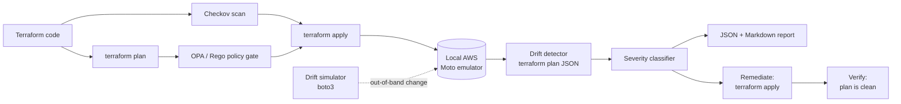

# IaC Drift Guard


[](https://github.com/RaiSpoorthi/iac-drift-guard/actions/workflows/pipeline.yml)


**A DevSecOps pipeline that catches insecure changes made to cloud infrastructure outside of code, rates how dangerous they are, and automatically puts the infrastructure back to its secure state.**

Teams define AWS infrastructure in Terraform, but people still change things by hand in the console: a port opened "just for debugging", an S3 bucket made public, an IAM role given `*`. The code says one thing and reality says another. That gap is **configuration drift**, and in a security team it is often how a breach starts.

DriftGuard closes that gap:

1. **Prevent**: Checkov and custom OPA/Rego policies block insecure Terraform before it is deployed.
2. **Detect**: it compares live infrastructure with the Terraform code and pinpoints every resource that changed.
3. **Classify**: each change is rated `CRITICAL` / `HIGH` / `MEDIUM` / `LOW` by what it means for security, not just that something changed.
4. **Remediate and verify**: it re-applies the declared state and proves no drift remains.

Everything runs against [Moto](https://github.com/getmoto/moto), an open-source local AWS emulator. **No AWS account, no credit card, ₹0 cost.** A built-in guard refuses to run against any real AWS endpoint.

---

## Architecture



The whole loop runs in **GitHub Actions** on every push, on pull requests and once a day, and publishes the report to the job summary.

## What it detects

| Scenario (simulated by hand) | Resource that drifts | Severity |
|---|---|---|
| SSH opened to `0.0.0.0/0` | `aws_security_group.app` | **CRITICAL** |
| S3 public access block switched off | `aws_s3_bucket_public_access_block.data` | **CRITICAL** |
| IAM inline policy replaced with `Action: "*"` | `aws_iam_role_policy.app` | **CRITICAL** |
| Default KMS encryption deleted from the bucket | `aws_s3_bucket_server_side_encryption_configuration.data` | **HIGH** |
| Bucket versioning suspended | `aws_s3_bucket_versioning.data` | MEDIUM |
| DynamoDB point-in-time recovery disabled | `aws_dynamodb_table.audit` | MEDIUM |
| Owner tag overwritten | `aws_vpc.main` | LOW |

The classifier also handles cases beyond these scenarios: RDP and all-traffic rules, IPv6 `::/0`, service wildcards like `s3:*`, wildcards hidden in a role's inline policies, deleted resources, and tag-only changes.

## Policy gate (before deploy)

| Rule | Tool |
|---|---|
| No SSH/RDP open to the internet | OPA/Rego |
| Every bucket has a public access block with all four protections on | OPA/Rego |
| Every bucket has default encryption | OPA/Rego |
| No wildcard (`*`, `service:*`) IAM actions | OPA/Rego |
| Mandatory `Project` / `Environment` / `Owner` tags | OPA/Rego |
| Built-in AWS best-practice checks (37 pass, 0 fail on this code) | Checkov |

The Checkov checks that are skipped are skipped inline, each with a written justification (see `terraform/main.tf`).

---

## Run it yourself

**You need:** Python 3.10+, [Terraform](https://developer.hashicorp.com/terraform/install) 1.6+, Git. No AWS account.

```bash
git clone https://github.com/RaiSpoorthi/iac-drift-guard.git
cd iac-drift-guard
python -m venv .venv
# Windows: .venv\Scripts\activate      macOS/Linux: source .venv/bin/activate
pip install -r requirements.txt
```

**Terminal 1**: start the local AWS emulator and leave it running:

```bash
moto_server -H 127.0.0.1 -p 5000
```

**Terminal 2**: run the full loop:

```bash
python -m driftguard run
```

This deploys the infrastructure, injects all 7 drift scenarios, detects and classifies them, remediates, verifies, and writes `reports/drift-report.md` and `reports/drift-report.json`.

### Individual commands

```bash
python -m driftguard scenarios                         # list drift scenarios
python -m driftguard deploy                            # terraform init + apply
python -m driftguard simulate --scenario open_ssh      # inject one (or more) drift scenarios
python -m driftguard detect --fail-on HIGH             # report; exit code 2 if HIGH+ drift found
python -m driftguard remediate                         # re-apply and verify clean
```

`detect --fail-on` makes it usable as a CI gate: the pipeline fails only when drift at or above the chosen severity is present.

### Tests

```bash
pytest -q                                   # Python unit tests (detector, classifier, simulator, CLI)
conftest verify --policy policies           # Rego policy unit tests (needs conftest)
checkov -d terraform --framework terraform  # IaC scan (pip install checkov)
```

---

## How detection works

`terraform plan` refreshes real state and `terraform show -json` exposes two things DriftGuard reads:

- `resource_drift`: what changed in reality since the last apply. This is the primary signal.
- `resource_changes`: what Terraform would do to fix it. DriftGuard uses this as a fallback, so a needed correction is never silently missed.

The detector diffs expected and actual attributes into exact paths (e.g. `versioning_configuration[0].status`). Empty-value noise (`null` vs `[]`) and values that are unknown until apply are ignored. Classification rules then judge the security meaning of each change. For example, a newly opened world-reachable admin port is `CRITICAL`, but a rule that was already open and only had a tag change is `LOW`.

## Project structure

```
├── terraform/            # 10 AWS resources: VPC, SG, KMS, S3 (+PAB, SSE, versioning), DynamoDB, IAM
├── policies/             # OPA/Rego policy gate + Rego unit tests
├── driftguard/
│   ├── detector.py       # plan JSON -> drifted resources + changed attribute paths
│   ├── classifier.py     # security severity rules
│   ├── simulator.py      # 7 out-of-band drift scenarios (boto3)
│   ├── report.py         # JSON + Markdown reports
│   ├── terraform.py      # Terraform CLI wrapper
│   └── cli.py            # deploy / simulate / detect / remediate / run
├── tests/                # pytest suite (runs fully offline with moto)
└── .github/workflows/    # CI: lint, tests, Checkov, Rego tests, policy gate, drift e2e
```

## Limitations

- An emulator is not real AWS. Moto is accurate for these services, but behaviour can differ at the edges.
- Remediation is "re-apply the code". That's the right default for security drift, but some teams prefer to review or import intentional changes first.
- The classifier covers the resource types in this lab. New resource types fall back to a generic `MEDIUM` / `HIGH`.

## Background

I originally built this as a team project during my B.E. in Computer Science (Cyber Security) at Dayananda Sagar College of Engineering. This repository is my re-implementation of it, designed to run entirely on a local emulator so anyone can reproduce it at zero cost.

**Author:** Spoorthi Rai · [LinkedIn](https://linkedin.com/in/spoorthi-rai)
